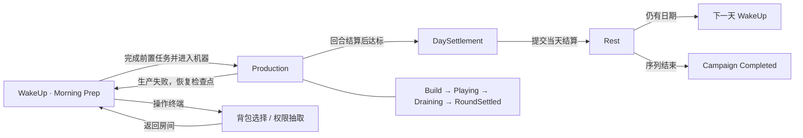

# 每日挑战运行架构

每日流程使用 `MarbleSimulation` 的 ECS World。`TestScene` 通过 `StartWithDayCampaign` 从 `Resources/GameDays.json` 启动 Day0。入口可在控制器启动前用 `ConfigureDayCampaign` 提供配置变换，也可显式把日期定义传入 `TryStartDayCampaign`。启动后由 `DayFlowSystem` 执行日期和生产状态转换。

`PrepareDayProduction` 应用盘面、血珠曲线、目标分、生产规则和初始残料。`ProductionSettings` 独立配置装置供给、生产货币、实时安装、耐久销毁、装置收回、出售和日结清理。运行系统读 ECS 的生产规则，UI 从 `SessionSnapshot` 读取同一份规则和余额。背包负责装置类型权限与选择，钱包负责资金和通关奖励。

## 权威状态与命令

| 所在位置 | 职责 |
| --- | --- |
| `SimulationContext.RoundEntity` | `RoundData` 持有内层阶段和本回合指标。`CampaignData` 保存公司工票余额。版本 3 的 ECS Buffer 保存选择、类型权限、货架和已发奖 Day ID。 |
| `SimulationContext.PlayerEntity` | `PlayerData` 保存血量和血肉残料，当天检查点可恢复生产钱包。 |
| `DayStateMachine`、`DayFlowSystem` | 校验命令与状态，串行提交转换、发送进入和退出通知，并独占 Day Index 写入。 |
| `GameDaysLoader`、`DayCampaignDefinition` | 复用项目的配置 JSON 读取器检查语法和字段类型。校验日期顺序和引用后发布不可变定义，配置通过后才允许切换正在运行的会话。 |
| `MarbleGameController.Day` | 提供只读进度、三个外层阶段完成命令和启动入口。Controller 在固定步之间轮询待完成的 Action，并在恢复时同步发射器和盘面。 |
| `DayEventSystem`、`DayRuleSystem` | 监听低频边界、执行类型化事件、管理规则来源和 Feature 生命周期。数值效果由 `AttributeRuntime` 与 `AttributeMath` 计算。 |

`DayProgressSnapshot` 给出当前 Sequence/Day ID、进度、Attempt、上一阶段、转换原因、结算标记、已结算回合数、生产 Tick 和随机状态。外层 UI 从快照取得 `Version` 并传给 `TryCompleteWakeUp`、`TryCompleteDaySettlement` 或 `TryCompleteRest`。版本过期、阶段不匹配和生命周期尚未结束时，命令返回具体原因。有效命令可以等待异步退出 Action，期间重复提交仍会被拒绝。退出通知完成后清理阶段规则，提交状态，再应用进入规则和通知。

启动 Day 时重用整局初始化。生产失利会自动恢复到当日检查点。通关时在 DaySettlement 入口按 Day ID 发放工票、清空残料并清理盘面。`TryCompleteDaySettlement` 推进到 Rest。完成 Rest 后增加 `CompletedDays` 并推进日期。最后一天完成后，Campaign 进入 `Completed`，Day 阶段保留为 `Rest`。

## 生产与结算

每次尝试运行一个生产回合。`CampaignSettlementSystem` 用该回合最终分数判定是否达成 `targetScore`。主动拨动开关会停止供血并进入排空。旧独立机台及版本 2 Day 继续使用原有库存和金币结算规则。

`defaultProductionFeatures` 启用整段序列共用的功能，各日可以通过 `productionFeatures` 增设功能。当前序列从 Day0 起启用 RUSH。关闭转盘时，分区按普通得分区即时计分。Day 0、Day 1、Day 2 的目标依次为 50、200、240 分，权限抽取由各日的 `shopEnabled` 控制。

适配器在现有 `BeginRound`、`CashOut` 和完整的 `AfterPhysics` 边界取结果。`SettlementComplete` 首次生效时发布 `RoundSettled`。若同一步进入排空并完成结算，先发 `DrainingEntered`，再发 `RoundSettled`。`Won` 和 `Lost` 分别触发 `ProductionSucceeded` 和 `ProductionFailed`。外层发射和布置命令只在无待处理生命周期的 Production 阶段可用。

## Morning Prep

Morning Prep 属于 `WakeUp`。ECS 保存当前尝试的目标完成记录，剩余目标为零且背包已确认后，`TryCompleteWakeUp` 才可进入生产。`MorningPrepController` 按配置生成房间物件，在进入事件结束和自由相机就绪后淡入。玩家用 WASD 行走，按住鼠标右键转视角，靠近纸条按 E 阅读，关闭阅读窗口时提交目标。靠近弹珠机后按 E，镜头切换完成后由生产控制器接手。重试恢复晨间目标和相机起点。

晨间仍复用 `Prefabs/ShopTerminal.prefab`、`ShopUI` 和 `ShopEntered`。候选池由 `DayDefinition` 提供。免费权限及已购权限决定当日可选类型，工票交易只向权限 Buffer 发放类型。玩家确认背包后，到机台正面进入生产。货架首次打开时由 `CampaignShopSystem` 生成，关闭重开和失败重试共用当天的货架记录。

物品板只展示背包类型，Build 和 Playing 均可安装。每次落位沿用 `DevicePlacementSystem` 的占位检查，并在场景侧检查边界、障碍及在场弹珠。安装投影完成后按实例价格扣血肉残料。耐久由 `DeviceDurabilitySystem` 登记，耗尽后在固定步末销毁并发出 `DeviceBrokenEvent`。场景投影按实例增删，保留其它正在参与 PhysX 的装置。

## 事件与规则

- 每天进入时按 Trigger 建索引。每次发生以单调序号去重，事件按优先级从高到低排列，同级按 Event ID 的序数排序。Action 按数组顺序执行。条件返回 false 时保留本次 Attempt 的执行资格。
- ECS Buffer 保存 Event ID、发生序号、动作位置和执行状态。`OncePerAttempt` 每次尝试最多执行一次，`EveryOccurrence` 每个通知序号最多一次。Action 返回的 Task 未完成时，状态机和生产命令等待。失败会记录 Day ID、Event ID 和 Trigger，终止该事件的剩余 Action，继续执行同批后续事件。销毁时取消未完成 Action，并关闭其受控上下文。
- 规则由 `ruleId`、`sourceId`、作用域和运行句柄标识。Campaign 的来源为 Sequence ID，其余来源为 Day ID。Phase 伴随外层阶段进退，Temporary 在 Production 入口激活，以当天累计的已完成生产固定步计时，离开 Production 时结束。Day 规则持续到离开当天或重试，Campaign 规则持续到序列完成。
- Attribute 规则进入现有全局属性 Modifier Buffer，沿用可用操作、加法、乘法、覆盖优先级、同级后注册者优先和最终限幅。运行句柄与原有外部 Modifier 来源分开存储。Feature 作为代码注册的规则类型，按作用域激活，退出时先 `Deactivate` 再 `Dispose`。恢复检查点时重新建立活动的 Campaign Feature 和当日 Feature 的订阅。Feature 若有私有的持久玩法状态，应接入明确的 ECS 快照边界。

## 检查点、重试和物理

每次进入新 Day，在内层准备好无活动弹珠的 Build 后、安装当日规则和发出 WakeUp 通知前捕获 `DayCheckpoint`。独立的恢复对象复用组件类型和装置实体构建入口。原有 `MarbleSnapshot`、`SessionSnapshot` 与库存/商店快照继续提供外部读取。

| 状态 | 捕获与恢复 |
| --- | --- |
| 生产和资源 | `RoundData`、`CampaignData`、`PlayerData`、发射器及移动组件、商店报价、全局属性及其 Modifier Buffer、出生序列、稳定 ID 计数和固定步状态。 |
| 装置 | 库存实例、Definition ID、成对 ID、价格、位置、朝向、耐久、状态文本、实例/回合数值、装置属性、耐久去重键及效果延续组件。重建实体时重绑 Player、Board 和 Definition 引用。 |
| 日期 | 已完成天数、Day ID、日期下标和转换版本留在外层。清掉失败尝试的事件记录，恢复检查点中的规则记录，然后用相同配置重新初始化当前 Day，Attempt 增加一次。 |
| PhysX | `IMarbleDayPhysics` 负责其局部场景。ECS 删除球、清瞬态和接触/得分队列后，Bridge 退役活动球及池内对象、清扫掠与设备缓存、复原当时的破钉集合。受影响的装置表现被同步拆除并按已恢复库存重建，重新同步碰撞体和发射器。 |
| RNG | 默认恢复 WakeUp 前的 `RoundData.RandomState`。调用者可注入 `DayRetryRandomPolicy`，根据检查点和失败尝试状态返回新的共享流状态。商店、Lua、开奖仍消费同一条序列。 |

恢复时使用新的 Round ID 和表现版本，装置保存的回合编号按偏移重映射，退役球的延迟接触失效。Lua 环境及物理对象的新实例从 ECS 状态和资源重建，持久玩法数据应通过实例 Buffer 保存，表现缓存随重建及正常回合回调刷新。捕获点限定为无活动球的 Build，因此中途刚体姿态、外部场景脚本私有状态和跨应用存档属于后续扩展。PhysX 穿透概率当前由球身份派生，新的 Round ID 与 PhysX 求解均会限制完全复现。回放策略保证共享玩法随机流恢复。

跨日准备集中在 `PrepareDayProduction`。该入口补血、读取目标和残料初始值，重置当天选择、临时权限和货架。永久权限和公司工票随 Campaign 跨日保留。失败时 `DayCheckpoint` 恢复生产基线，保留晨间已确认的选择、权限、工票变化和货架，并回到本次进入生产时的随机状态。版本 2 的夹具仍采用原购买前检查点。`IMarbleBoardLayoutPhysics` 在捕获当天基线前投影配置盘面，重试复用当日盘面并通过物理检查点恢复破钉状态。Campaign 的钱包和权限在当前会话内维护。

## 文件索引

| 目录 | 文件与职责 |
| --- | --- |
| `Scripts/Day/` | `DayDefinitions` 与 `DayBehaviorRegistry` 定义内容和代码注册，`DayRuntime`、`DayStateMachine`、`DayFlowSystem` 驱动流程，`DayEventSystem`、`DayRuleSystem` 管理生命周期，`DayCheckpoint` 保存恢复数据。 |
| `Scripts/Simulation/` | `MarbleSimulation.Day.cs`、`MarbleGameController.Day.cs` 对接现有固定步、外部命令、生产结果和场景投影。 |
| `Scripts/Session/`、`Scripts/Marbles/` | 生产回合结算发放当日奖励，库存创建和检查点重建共享装置实体构建入口。属性 Modifier 记录规则句柄，`IMarbleDayPhysics` 定义物理检查点边界。 |
| `Scripts/Physics/PhysX/`、`Scripts/UI/`、`Scripts/Presentation/` | Bridge 与盘面投影实现物理清理和重建，现有按钮遵循生产命令可用性。 |
| `Resources/`、`Scripts/Configuration/`、`Editor/Validation/` | `GameDays.json`、`GameDaysLoader.cs` 和 `GameDaysValidation.cs` 提供制作、加载和校验入口。 |
| `Tests/Day/` | `DayFrameworkTests.cs` 和 `DaySceneTests.cs` 覆盖配置、ECS 流程、实际物理和旧场景。 |

## 验证入口

运行 `Marbles ECS → Validate Day Configuration` 验证 `GameDays.json`。空序列给出 `DAY_CONFIGURATION_UNCONFIGURED`。Unity Test Runner 中 `MarblesECS.Day.EditMode.Tests` 和 `MarblesECS.Day.PlayMode.Tests` 验证状态、检查点和实际场景。编辑器内容验证继续用 `Marbles ECS → Validate Attribute and Content Runtime`。数值工具继续使用 `Tools → Pachinko → Balance`。字段和扩展入口见 [每日内容制作指南](DayFramework_Content_Guide.md)。

本次在 Unity 2022.3.62f3c1 的隔离副本中验证。新增的 10 项 EditMode 和 3 项 PlayMode 测试通过。全量 EditMode 通过 64 / 65 项，全量 PlayMode 通过 9 / 9 项。内容验证通过 11,832 条断言，空 Day 配置校验、Excel 导入和使用已有数据的 Dashboard 加载均完成。

改造前提交 `9ffbaa6` 可复现三项回归检查失败。MResPacker 物理材质测试读到的反弹系数为零，预期为 0.7。Balance 物理采样在场景发射口拒绝生成弹珠。使用现有采样报告运行经济模拟时，Python 仍读取已撤下的 `Drugs` 字段。运行报告位于项目根的 `.utmp/day-framework-9ffbaa6/`，基线报告位于 `.utmp/day-framework-baseline-9ffbaa6/`。
