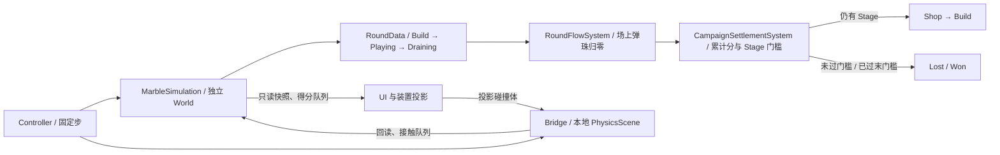

# 每日挑战架构审计

这份历史审计以提交 `9ffbaa6` 为基线。现行流程见 [每日挑战运行架构](DayFramework_Architecture.md)。项目版本为 Unity 2022.3.62f3c1、Entities 1.0.11、URP 14.0.12。核对了项目根的《项目结构分析》、`Docs/Implementation.md` 和当前源码。结构分析中的药物和开奖等待描述已过时。当前没有药物运行管线，回合提交也无需等待轮盘 UI 动画。

## 当前流程与数据所有权

| 核对点 | 当前实现 |
| --- | --- |
| Campaign / Stage / Round | `CampaignData` 保存累计分、钱包、当前 Stage、布局版本等。Stage 是 `GameBalance.Stages` 中的累计分门槛、奖励和提现率，可以一次越过数个。Round 是一次补血、发射、排空和结算，`RoundData` 另存分数、轮盘、Rush、计时和 RNG。 |
| 谁推进阶段 | `StartSession` 写 Build，`BeginRound` 写 Playing，提现或 `RoundFlowSystem` 写 Draining。排空后 `CampaignSettlementSystem` 写 Lost、Shop 或 Won。Shop 的继续命令返回 Build。没有独立 RoundSettlement 状态，`SettlementComplete` 是结算提交标记。 |
| 输赢与重开 | 输赢保留结算后的分数、钱包和布局。结算清掉回合内的持续装置效果、全盘效果和发射输入。旧重开由 Controller 恢复被破坏的钉子，`StartSession` 回收弹珠、清队列、重建初始库存及属性、重置累计分和钱包，再按开局设置初始化同一条共享 RNG。空待布置库存会自动开首轮。 |
| 已有 Snapshot | `MarbleSnapshot`、`SessionSnapshot`、库存、报价和单球快照均为只读投影。没有恢复协议。投影没有涵盖完整计时、RNG、属性和装置 Buffer、Entity 引用、队列和脚本状态。也未发现跨应用存档。 |
| PhysX 边界 | Bridge 对弹珠 Rigidbody、碰撞和池负责，ECS 用 `MarbleKey` 对应实体并回读位置速度。回收会禁用 Collider、清碰撞忽略和场状态。池内对象保留到 Bridge 销毁。`DevicePlacementUI`（TestScene）及 `MarbleBoardView`（旧 HUD）负责按 ECS 库存构建 MRes 碰撞体和外观。破钉与装置瞬态视觉由 Bridge 另行记录。 |
| ECS 与场景 | 血量、分数、库存、耐久、布局和发射器输入/移动状态在 ECS。World 由 Simulation 独立拥有。场景持有台面、分区、障碍、发射点、摄像机和输入；Controller 不持有玩法资源副本。装置 Lua 环境持有表现/回调对象，持久和回合数值各有 ECS Buffer。 |
| 配置 | `GameBalanceLoader` 用 JsonUtility 读 Balance / Content，运行装置目录取自 MRes。校验后返回副本，Simulation 再拥有自己的副本。Excel 导入器先校验再发布 Balance JSON；场景几何和 MRes 不走 Excel。 |
| 消息和属性 | 高频接触由 Bridge 入队、ECS 消费；得分有专门队列，Controller 输出表现回调。装置的 Lua 回调属于独立实例。全局、设备和球属性由 `AttributeRuntime` 读 `AttributeModifierData`，现有 `AttributeMath` 定义加、乘、按优先级覆盖。商店、初始装置、Lua 随机与开奖共用 `RoundData.RandomState`；穿针判定另按球身份在 Bridge 派生状态。 |
| 验证入口 | `Editor/Validation` 有内容、商店和真实场景等验证；Unity Test Framework 现有测试程序集主要覆盖 MRes。Balance Dashboard 与 Batch 直接使用旧场景、物理桥和数值工具。 |

## 执行与销毁顺序

Controller 初始化配置、局部物理场景、Simulation 和 Bridge，将 `PhysicsRoot` 移入局部场景再开局。每步按发射器输入和移动、Lua Tick、计时、Rush、叠加分、轮盘、重力、属性、效果生命周期、发射、全盘效果、PhysX 子步、回读、滞留、接触结算、瞬态、逐球装置、回收、回合流转的顺序调用。玩法系统为显式调用的普通 C# 系统。退出时 Controller 释放 Bridge、Simulation、局部场景和材质；Simulation 回收实体、装置 Lua 和瞬态，再释放 World。

## 接入边界

- 在同一 World 的 Session 数据旁承载 Day 生命周期。Controller 和旧 UI 通过命令及投影访问。
- 让生产计划指出受现有结算系统管辖的 Stage 范围。已提交的 Lost / Shop / Won 分别表示该计划失败、继续和达标。回合结算信号与当天结算信号分开。
- 在无活动弹珠的 Build 边界捕获当天检查点，再触发 WakeUp。保存组件、必要 Buffer、设备身份与归属、共享 RNG，清理物理和投影后重建。使用新的运行身份防止退役接触误入。Day 历史进度位于检查点之外。
- 低频事件在命令、阶段边界及结算提交时派发。数值作用通过现有属性管线，把作用域和来源留在 Day 层。

