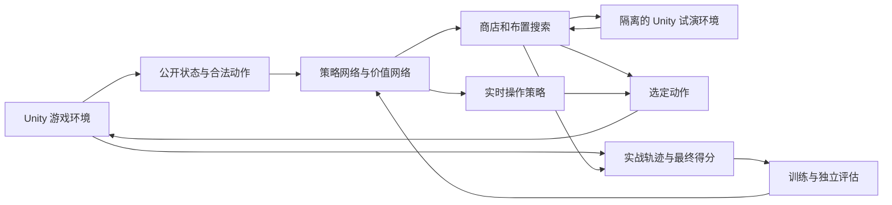

# 自主学习游戏 AI 设计

日期：2026-10-15。状态：首版环境接口、策略/价值网络、PPO、边界搜索和回放代码已落地；Python 与 Unity 测试、真实物理对局、CPU 短训练、搜索续训及跨进程回放已通过。运行方式和当前能力边界见 [AI 使用说明](AI/使用说明.md)，实测记录见 [首版验证报告](AI/首版验证报告.md)。下文保留目标架构，尚未实现的高级能力以使用说明为准。

## 1. 目标与路线

目标是让 AI 通过实际玩游戏，自主学习购买、布局、发射、装置激活、药物和提现决策，最大化一整局最终结算总分的期望。不预设玩家性格、装置排名或最佳组合。

采用适配单人随机游戏的“策略网络 + 价值网络 + 搜索 + 强化学习”。AlphaGo Zero 中，网络指导搜索，搜索产生更好的动作分布，实际对局结果再用于改进网络；本项目借鉴这一循环。这里没有对手，训练样本来自 AI 反复挑战游戏。[DeepMind 对 AlphaGo Zero 的说明](https://deepmind.google/blog/alphago-zero-starting-from-scratch/)

推荐最终架构：商店和布置阶段使用神经网络引导的蒙特卡洛树搜索（MCTS）；实时阶段使用学到的操作策略，待状态恢复和性能达标后再增加短时搜索。它是针对本游戏的分层设计，不是直接复刻围棋算法。

“人为定义合法操作与输入信息”和“人为规定怎样玩才能赢”需要区分。前者是训练环境的规则接口；后者交给学习与搜索发现。

## 2. 当前项目的基础和缺口

以下判断来自当前工作目录的代码；没有采用已删除的旧数值模拟工具或测试报告。

| 当前基础 | 可以复用的能力 | 需要补充的部分 |
| --- | --- | --- |
| `MarbleSimulation` 独立 ECS World | 初始化、规则推进、得分与阶段流转 | 训练环境的统一 Reset/Step 接口 |
| `BeforePhysics → MarblePhysicsBridge.Simulate → AfterPhysics` | 实际游戏的物理和规则链路 | 与渲染帧独立的完整固定步驱动 |
| `BuyOffer`、`PlaceDevice`、`FireOnce` 等命令 | 执行游戏操作 | 共享合法性检查、动作编码、操作结果记录 |
| `Snapshot`、`Session`、库存与商店快照 | 读取部分观察信息 | 全部球的公开状态、装置动态状态、发射器相位等 |
| `RandomSeed`、回合和战役随机状态 | 控制部分随机过程 | 搜索分支独立随机源、可复核的实验记录 |
| Lua 装置、延时效果和物理对象 | 完整装置玩法 | 状态保存、重建、清理和分支隔离契约 |

现有 Snapshot 是只读数据视图，不能直接用来恢复完整局面。搜索需要的分支环境还涉及 ECS buffer、球与物理对象映射、耐久、装置储存状态、Lua 状态、计时器、临时对象、发射队列与随机过程。

放置合法性目前分散在 UI、Controller 和 Simulation：Simulation 主要检查装置间距，Controller 还检查场景障碍。训练时必须提取并复用完整检查，不能只调用底层 PlaceDevice 就认定与玩家权限相同。

当前 `TestScene` 的 `AutoMoveLauncher` 为开启状态。默认实验保持该模式，让 AI 学习随发射器运动选择发射时机。手动移动模式应作为单独任务配置，遵循实际允许的控制方式。

## 3. 总体结构



Unity 负责真实规则与物理；Python/PyTorch 负责训练和搜索调度。一个 Unity 工作进程内的 Unity API 仍在主线程调用，优先使用多个独立进程采样，避免假设可以从 Python 线程并行操作 Unity 物理场景。

## 4. AI 看见什么、可以做什么

### 4.1 观察

首版使用结构化数据，暂不增加从屏幕图像识别游戏状态的任务。

| 信息组 | 内容 |
| --- | --- |
| 全局 | 当前阶段、目标分、已确认分、待结算分、血量、金币、药效、Rush、游戏时间 |
| 盘面 | 实际可放置区域、障碍与终点几何、装置位置和朝向 |
| 装置 | 类型、公开属性、剩余耐久、玩家可见的充能/储存/激活状态 |
| 弹珠 | 位置、速度、公开可见的球类型和效果；变长列表配有效项掩码 |
| 发射器 | 位置、移动方向/相位、可发射状态、投入设置 |
| 经济 | 当前商店报价、库存、出售价格和刷新费用 |
| 历史 | 必要的过去观察/动作，或由循环网络记忆的短期历史 |

结构化精确位置和速度属于较理想的信息条件，应在报告里说明。它适合先研究策略能力；后续可另做观察精度和反应延迟实验。

禁止提供未来商店结果、未公开的随机结算结果或实际随机种子。调试用内部状态与模型观察分开。若装置有玩家无法直接观察的状态，由历史推断，不能悄悄转成全知输入。

### 4.2 动作

| 阶段 | 动作 |
| --- | --- |
| Shop | 购买某报价、刷新、出售某实例、结束购物 |
| Build | 选择实例并放到某位置、旋转、撤下、出售、合法的装置供奉/组合操作、开始回合 |
| Playing | 发射/停止发射/等待、调整实际允许的投入、激活装置、用药、合法时提现 |
| Draining | 环境继续推进；只允许实际游戏此阶段允许的交互 |
| Won/Lost | 返回终局结果，由训练器重开 |

动作分层编码为“操作类型 → 对象 → 参数”。放置位置先按实际盘面生成有限候选，朝向和投入也先离散化；候选精度是模型能力限制，要写入实验配置。逐步细化位置和角度，避免宣称粗网格上的最优就是整个游戏的最优。

合法动作掩码必须根据已选类型、对象和参数逐级计算。例如某位置只适合小装置，不能把位置掩码与装置选择完全独立处理。所有提交仍经过正式命令校验。

实时操作先每 6 个游戏固定步决策一次；以当前约 1/60 秒固定步计，即约 0.1 秒。动作在期间保持，阶段变化时提前返回。这只是初始实验参数，之后比较 1/3/6/12 步的精度与算力成本。等待也是有时间成本的操作，不能跳过物理推进。

## 5. 网络设计

建议用共享状态编码器，加商店、布局、实时操作三个策略输出头和一个价值输出头。动作头根据阶段启用，参数间采用条件选择。

- 盘面几何用小型卷积编码器；装置、球和商品用带掩码的集合编码器；全局数值用小型全连接网络。
- 对象数量变化时采用变长输入或明确的容量上限；容量溢出必须记录，不能静默漏掉球或装置。
- 若公开观察不足以描述动态状态，加入循环记忆；不要单靠一张静态盘面预测运动。
- 策略头回答“哪些合法操作值得尝试”；价值头预测“从这里继续玩，预期还能获得多少最终分数”。

模型可以知道装置的身份和规则数值，但不会获得人工编写的“这件装置强度为 90 分”或固定连招评分。

## 6. 搜索怎样工作

### 6.1 商店和布局搜索

每次真实决策执行下列循环：

1. 网络给合法动作生成先验概率，并评价当前局面。
2. 搜索选择值得进一步探索的动作，在隔离环境中执行。
3. 若仍在商店/布局阶段，继续扩展购买、摆放、旋转或开始回合等动作。
4. 到达实时阶段时，用冻结版本的实时策略推进；需要时试演至回合结束或终局，较短试演在叶节点由价值网络补足剩余收益。
5. 将试演中的实际增分与叶节点剩余价值回传，更新动作访问次数与平均收益。
6. 用搜索访问分布训练策略，在真实游戏中执行选定动作。

搜索必须覆盖“买下 → 有机会摆放 → 开始回合 → 产生收益”的链条。只看购买之后的即时分数，无法学会投资装置。训练早期的价值网络不可靠，应混合足够的完整回合/整局试演，避免完全依赖未训练的估值。

候选多时，先扩展少量动作，再随搜索预算增加而扩大候选集合。候选来自网络概率并保留随机探索，不能永久限定在人工挑选的几个位置或组合。

树节点记录平均未来收益、访问次数和策略先验。使用 PUCT 一类选择方式平衡探索和利用，并对价值尺度做统一处理。单人游戏回传收益时不进行对手视角的正负翻转。

### 6.2 随机结果

购买后的刷新结果、赌博等随机事件是机会分支：按游戏规定分布采样，累计动作的平均收益。搜索不能像选择玩家动作那样选择“这次开奖赢了”这个分支。

每个候选要评估多个独立未来样本，不能因为一次中大奖就判为最优。初始搜索预算可比较 32/128/512 次扩展，但真实取值要根据实测吞吐量决定。

实际对局与搜索使用相互独立的未来随机流。不能复制当前游戏的真实 RNG 状态后沿其唯一未来搜索，否则 AI 可以提前知道未公开的开奖结果；仅从网络输入中删掉种子并不足以解决这个问题。

若还存在其他隐藏状态，搜索节点按可观察历史组织，模拟内部状态应来自与历史一致的估计，而不能使用实际隐藏真值替 AI 做决策。

### 6.3 实时搜索

第一版由学到的实时策略直接决定等待、发射、投入和激活。商店/布局搜索以它作为回合试演的操作者。

完整动态状态恢复通过验证后，可在关键时刻比较“立即发射、再等若干步、激活某装置”等候选，用有限时域试演和价值网络估值，只执行选定序列的第一步，再重新观察。该能力作为后续阶段，不让首版依赖每个物理步都做大型树搜索。

离线实验允许为 AI 暂停模拟等待计算，但搜索期间游戏时间如何处理必须明确。实时运行应设固定决策预算并报告超时比例。

## 7. 训练目标与训练循环

### 7.1 奖励

主目标为 `J = E[整局最终结算总分]`。每局从 StartSession 到 Won/Lost，所有购买和操作均对这一结果负责。

初版使用终局分数奖励，并按固定正常数缩放。之后可改为已经实现的增分奖励，只要整局奖励之和严格等于最终分数减初始分数，且结算时不重复计分。有限完整对局采用不折扣回报；若算法实现引入折扣或时间惩罚，要明确这会改变优化目标。

不给碰撞次数、发射次数、装置触发次数或买入数量单独加分。它们是诊断指标，单独奖励容易让 AI 学会制造动作而不提高最终得分。金币和血量首先作为未来收益的条件输入。

过关率、低分局表现和游戏时长作为独立指标。若改为“优先过关”或“限制时间内最高分”，需另设任务，不能在没有说明的情况下把这些偏好混入主目标。对分数取对数作为最终效用也会改变风险偏好，因此不作为默认奖励。

### 7.2 自我改进

1. 从合法随机探索和小模型开始，采集真实环境轨迹。
2. 用若干可达的盘面/库存训练实时操作，先学会发射和等待；任务逐步扩大到完整商店和多回合。训练用起始状态必须标注，最终评估始终从正式开局开始。
3. 环境与数据链路稳定后启用商店/布局搜索，收集“观察、合法候选、搜索访问分布、实际回报”。
4. 策略拟合搜索分布；价值拟合真实轨迹的剩余回报。实时策略用强化学习更新。
5. 固定一个模型版本生成一批样本，再更新下一版本。搜索缓存、轨迹和价值标签都带模型版本，避免操作者变了以后继续混用旧评估。
6. 在独立验证种子上比较新旧模型，通过后保存新检查点；最终测试集只用于最终评估。

高层搜索的常规训练损失为策略交叉熵与价值回归损失的加权和。实时操作可先使用 PPO。PPO 更新应使用该实时策略自身采集的相应数据；被搜索改选的高层动作不能假装是原策略的在策略样本。

Unity ML-Agents 提供 PPO 等训练器，可用于先验证实时策略。分阶段自回归动作、搜索器和访问分布蒸馏需要额外实现，安装 ML-Agents 并不会自动获得 AlphaGo 式搜索。[Unity ML-Agents 训练配置](https://unity-technologies.github.io/ml-agents/Training-Configuration-File/)

## 8. 环境实现要求

### 8.1 拟新增接口

```text
Reset(taskConfig, episodeSeed) -> observation, legalActions
Step(action, maxTicks) -> observation, reward, terminated, truncated, info
GetObservation() -> playerObservation
GetLegalActions(partialAction) -> legalChoices
CreateSearchBranch(history, searchRandomSource) -> isolatedEnvironment
ExportTrace() -> actions, ticks, outcomes, model/config versions
```

这些是目标接口，目前项目中尚不存在。公开观察、内部恢复状态和实验日志是三种不同的数据契约。

### 8.2 固定步与真实玩法一致性

训练 Runner 复用正式 ECS、PhysX Bridge、Lua 装置和结算规则，去掉键鼠采集对 AI 指令的覆盖。每步完成发射器推进和 Transform 同步、BeforePhysics、Physics 同步、Bridge.Simulate、AfterPhysics，以及必要事件消费。

加速通过减少渲染、连续推进更多固定步及增加工作进程实现，游戏固定步和 Bridge 内现有自适应物理子步算法保持与正式版本一致。Unity 文档建议固定步以改善可重复性，也明确 Editor 非 Play Mode 物理模拟不会产生常规脚本接触回调；训练主环境应使用运行时 Player 或经过验证的 Play Mode 路径。[Unity 2022.3 PhysicsScene.Simulate](https://docs.unity3d.com/2022.3/Documentation/ScriptReference/PhysicsScene.Simulate.html)

还需审查 MRes 的 Update/FixedUpdate、Lua runtime driver、碰撞体激活等生命周期。只在 for 循环中调用 PhysX，并不自动执行所有 MonoBehaviour 生命周期。

赌博展示完成后才提交结算。无表现训练环境应在结果已经产生且规则允许时调用现有 CompleteRandomScoreReveal；不能因没有 UI 而永久卡在 Draining，也不能提前泄漏结果。

### 8.3 分支与恢复

首版先支持场内无球、没有未完成回调的 Shop/Build 决策边界。清点该边界所有仍存活的状态，不能假设没有球就没有装置/Lua 状态。

初始原型可从正式开局重放动作到搜索根节点，再改变未来操作；这一路径只在同一环境内重放一致性通过时使用。重放不一致时必须修复环境或建立明确的恢复机制，不能把不同局面当成同一搜索根。

随后实现边界状态显式导出/导入。动态中途恢复还要处理 Rigidbody 运动、关节、滞留/悬停、碰撞状态和延时回调。仅复制位置和速度不等于完整恢复 PhysX；需用相同动作后续试演的轨迹与奖励差异验证可接受误差。

真正难以完整恢复时，可保留边界搜索加实时策略的架构；学习近似动力学属于后续研究，不能用未经验证的简化模型给出“已掌握真实游戏”的结论。

### 8.4 可结束性与异常

训练设置操作数和模拟时间上限防止无限等待、来回旋转或无穷重排。达到技术上限记为 truncated，游戏失败记为 terminated，分别统计，不能把截断局当作正常胜负或静默丢弃。

先检查游戏规则是否存在可无限增分的循环。如果目标本身没有有限上界，就需要明确有限时间/操作预算或调整规则，然后重新定义实验；不能宣称此时已经找到全局最优策略。

## 9. 评估与实验产物

所有模型在独立测试种子上从正式开局跑完整流程。比较：合法随机基线、只用网络、网络加不同搜索预算、上一版模型。随机基线只用于检查学习是否有效，不承担玩家人格模拟。

必须报告：

- 最终总分均值、中位数、分位数和置信区间；不得只挑最高分录像。
- 各阶段通过率、正常终局率、技术截断率、非法动作率。
- 实际步数/秒、完整局/小时、决策延迟、搜索耗时与内存。
- 购买与布局轨迹、装置有效触发与耐久消耗、发射间隔、等待、提现及药物使用情况。
- 固定同一测试种子集合的新旧模型对照；不同策略会消耗不同随机序列，相同初始种子不代表逐事件随机结果完全相同。

性能评估先用单工作进程，再测试 2/4 个进程等配置，按本机 CPU、内存和实测瓶颈扩展。网络训练可使用 GPU，但物理采样吞吐量可能首先限制训练速度；在测量前不给出训练若干小时即可达到某水平的承诺。

检查点和轨迹记录代码提交/工作区差异、Unity 版本、数值配置、场景、MRes 装置资源哈希、动作/观察版本、模型版本和随机种子。内容变化后重新验证旧模型。

拟新增正式目录：`Assets/Scripts/AI/` 放环境与运行接口，`Tools/GameAI/` 放训练和搜索程序，`docs/AI/` 放保留的实验报告。首轮临时日志、预览、轨迹和训练中间产物放项目根目录 `.utmp/game-ai/`。Python 的 TEMP/TMP 与缓存也放项目内，设置 PYTHONDONTWRITEBYTECODE=1；Unity 批处理使用项目内 -logFile。

## 10. 分阶段交付与验收

| 阶段 | 交付 | 通过条件 |
| --- | --- | --- |
| A：真实训练环境 | Reset/Step、合法动作、全流程自动运行、轨迹记录 | 相同动作在训练/正式链路下的资源、阶段和得分一致；随机回放误差有记录；不漏 Lua/物理生命周期 |
| B：学会实时操作 | 实时策略与价值网络 | 在未训练过的可达布局上超过合法随机基线；能等待、发射并完成结算 |
| C：学会购买与布局 | 边界分支、MCTS、搜索蒸馏、多回合训练 | 从正式开局完成全流程；同一测试集上搜索改善收益；不同预算成本可量化 |
| D：扩大能力 | 更细动作、更多内容、可选实时短时搜索 | 收益提升在独立测试集和正式运行环境成立，恢复误差与延迟满足预算 |

首个可用成品以阶段 C 为目标：AI 自己完成购物、摆放、发射和结算，并输出可回放的打法与统计结果。阶段 A/B 是实现它所需的工程和学习里程碑。

本方案追求通过实验持续提高策略强度；有限训练、有限搜索和离散动作都不能保证找到全局最优，也不能直接把该 AI 的表现当成普通玩家表现。
