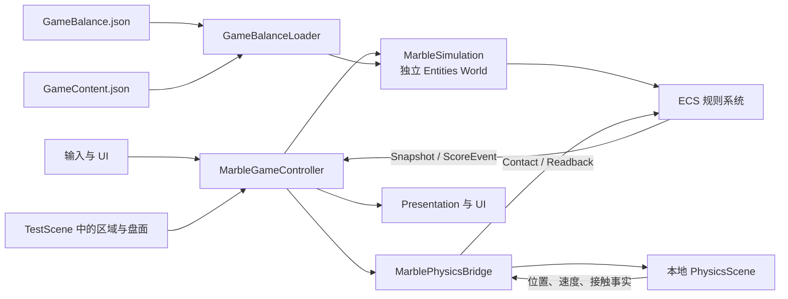
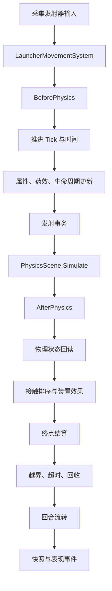
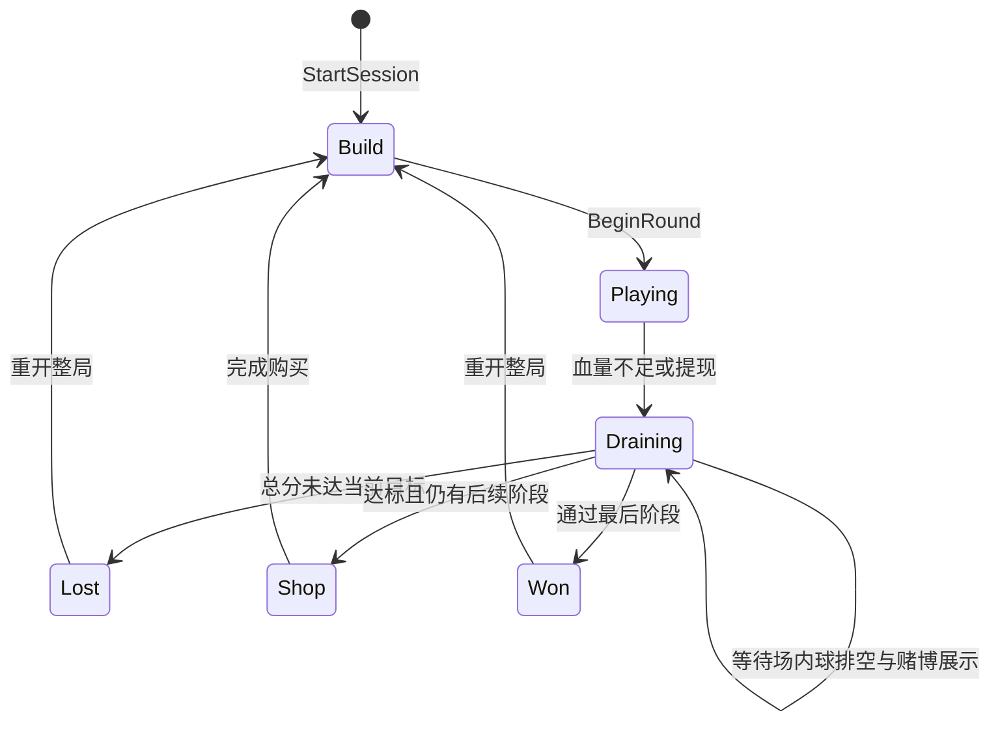

# MarbleRoguelikeGame 项目结构分析

## 1. 项目定位与当前规模

这是一个 Unity 三维弹珠 Roguelike 原型。玩家用血量发射血珠，依靠物理路径、装置、药物、Rush 和赌博分区取得分数与金币，并在阶段间购买、布置内容。

当前仓库共有 662 个受 Git 管理的文件，其中 154 个 C# 文件、2 个场景、20 个 Prefab 和 3 个 Excel 工作簿。核心运行场景是 `Assets/Scenes/TestScene.unity`，`ArtScene.unity` 不在构建列表中。

当前技术基线以仓库文件为准：

| 项目 | 当前值 | 来源 |
| --- | --- | --- |
| Unity | 2022.3.62f3c1 | `ProjectSettings/ProjectVersion.txt` |
| Entities | 1.0.11 | `Packages/manifest.json` |
| URP | 14.0.12 | `Packages/manifest.json` |
| Cinemachine | 2.10.7 | `Packages/manifest.json` |
| TextMesh Pro | 3.0.7 | `Packages/manifest.json` |
| Test Framework | 1.1.33 | `Packages/manifest.json` |

`Assets/Docs/README.md` 和 `Assets/Docs/Validation.md` 仍记录 Unity 2022.3.55f1c1、Entities 1.0.16 等旧环境，不能作为当前安装版本的唯一依据。

## 2. 顶层目录

```text
MarbleRoguelikeGame/
├─ Assets/
│  ├─ Art/                 美术模型、贴图、字体
│  ├─ Config/              基础数值工作簿 GameBalance.xlsx
│  ├─ Docs/                历史设计、实现和验证说明，以及内容规范工作簿
│  ├─ Editor/              Excel 导入、构建菜单、编辑器验证
│  ├─ Materials/           弹珠和钉子的材质、物理材质
│  ├─ Prefabs/             弹珠、UI 条目及 15 种装置 Prefab
│  ├─ Resources/           运行时读取的 GameBalance.json、GameContent.json
│  ├─ Scenes/              TestScene、ArtScene
│  ├─ Scripts/             运行时代码
│  ├─ Settings/            URP 配置
│  └─ TextMesh Pro/        TMP 资源
├─ Packages/               Unity 包清单和锁文件
├─ ProjectSettings/        Unity 项目设置、构建场景
└─ docs/                   面向接手者的新文档
```

Unity 自动生成的 `Library/`、`Temp/`、`Logs/`、`UserSettings/`、`Build/` 和 `Builds/` 均被忽略，不应提交。

## 3. 总体架构

项目采用“ECS 管玩法状态、PhysX 管运动、MonoBehaviour 管桥接与表现”的分层方式。



数据所有权要点：

- ECS 组件和 DynamicBuffer 是血量、得分、金币、阶段、库存、布局、Rush、药效和单球效果的玩法权威。
- Rigidbody/PhysX 是位置、速度和碰撞运动的权威。项目没有第二套 ECS 运动积分器。
- MonoBehaviour 只提交命令、推进固定步、桥接物理、读取快照和驱动 UI，不应直接修改玩法资源。
- `MarbleSimulation` 创建独立的 Entities World，不挂入 Unity PlayerLoop，由控制器显式按顺序调用。

## 4. 启动与固定步链路

### 4.1 场景启动

`MarbleGameController.Start()` 的主要过程如下：

1. `GameBalanceLoader` 读取 `GameBalance.json` 和必需的 `GameContent.json`。
2. 对阶段、库存、属性、装置和药物做完整校验，并创建深拷贝。
3. 校验 `PhysicsRoot`、发射点、固定步、区域 ID 和放置障碍物。
4. 创建独立 `PhysicsScene`，把 `PhysicsRoot` 移入该场景。
5. 创建 `MarbleSimulation` 和 `MarblePhysicsBridge`。
6. Campaign 模式调用 `StartSession()`，初始化金币、库存、装置和阶段。
7. 如果没有待布置装置，自动从 `Build` 进入首回合；否则先停在布置阶段。

`TestScene` 已设置 `EnableCampaign = true`，并直接绑定 `Assets/Resources/GameBalance.json`。

### 4.2 每个固定步



接触处理先执行非终点装置，再按球序号、终点优先级和稳定 ID 处理终点。因此，同一个物理步内的装置效果可以影响随后发生的得分结算。

## 5. 回合状态机



关键边界：

- 血量低于最便宜的一发时进入 `Draining`。
- 提现只能在“累计总分 + 本回合已确认即时分”达到目标且仍有血量时执行；赌博待定分不解锁提现。
- 赌博池非空时，逻辑先生成结果，再等待表现层完成开奖展示，之后才提交总分并判定阶段。
- 商店、库存和布局跨回合保留；重新开始整局时重置。

## 6. 运行时代码分区

| 路径 | 主要职责 | 接手时关注点 |
| --- | --- | --- |
| `Assets/Scripts/Marbles/Rules/` | 纯 C# 规则、数值结构、定义和校验 | 适合阅读公式与边界；尽量保持不依赖 Unity 表现 |
| `Assets/Scripts/Marbles/Component/` | 单球 ECS 组件 | 得分、属性、寿命、访问记录、结算状态 |
| `Assets/Scripts/Session/Component/` | 整局、回合、库存、商店 ECS 数据 | 跨回合资源的权威状态 |
| `Assets/Scripts/Launcher/Component/` | 发射器移动与输入状态 | A/D、自动往返、滑条请求 |
| `Assets/Scripts/System/` | 发射、接触、装置、计分、回收、Rush 和药效系统 | 核心玩法公式与执行顺序 |
| `Assets/Scripts/Session/` | 阶段结算、商店、布置 | 经济循环和阶段推进 |
| `Assets/Scripts/Simulation/` | World 编排、公开命令、快照、Controller | 系统边界与主循环入口 |
| `Assets/Scripts/Physics/PhysX/` | Rigidbody 对象池、碰撞上报、扫掠补检 | 高速穿透、材质隔离、局部物理场景 |
| `Assets/Scripts/Presentation/` | 盘面显示、相机、HUD、预览、世界文字 | 只读快照，不应承载规则 |
| `Assets/Scripts/UI/` | 商店、库存、放置和按钮适配 | 调用 Controller 的公开命令 |
| `Assets/Editor/Balance/` | 读取 xlsx、验证、发布 JSON | 基础数值表的生产链路 |
| `Assets/Editor/Validation/` | 编辑器验证菜单 | 内容和放置验证入口 |

推荐先读的代码顺序：

1. `MarbleGameController.Lifecycle.cs`、`MarbleGameController.Update.cs`
2. `MarbleSimulation.cs`、`MarbleSimulation.Campaign.cs`
3. `AttributeRuntime.cs`、`ContentSpawnSystem.cs`、`ContentSettlementSystem.cs`
4. `CampaignSettlementSystem.cs`、`CampaignShopSystem.cs`
5. `ContactResolutionSystem.cs`、`DeviceEffectSystem.cs`
6. `MarblePhysicsBridge.*.cs`

## 7. 配置与资源链路

配置不是单一文件，分为四类所有者：

| 数据 | 编辑入口 | 运行时入口 | 说明 |
| --- | --- | --- | --- |
| 血量、投入范围、发射间隔、容量、商店基础参数、阶段 | `Assets/Config/GameBalance.xlsx` | `Assets/Resources/GameBalance.json` | Excel 是编辑源，JSON 是运行源 |
| 34 个属性、15 种装置、12 种药物和内容规则 | `Assets/Resources/GameContent.json` | 同一文件 | 当前日常直接改 JSON |
| 区域倍率、Rush 概率、触发范围、盘面、放置范围 | `Assets/Scenes/TestScene.unity` | 场景组件 | 不在两份 JSON 中 |
| 装置碰撞体与外观 | `Assets/Prefabs/Devices/` | Prefab | 定义 ID 由场景 UI 绑定 |

基础 Excel 保存后，`GameBalancePostprocessor` 会延迟调用导入器。导入器先在内存中完成解析和交叉校验，成功后才覆盖 `GameBalance.json`；失败时保留旧 JSON。

内容规范工作簿 `Assets/Docs/血色柏青哥_道具药物装置_规范修订版.xlsx` 不会自动覆盖 `GameContent.json`。只有显式执行 `Marbles ECS/Import Attribute and Content Excel` 才会导入，而且自然语言行为描述变更会触发拒绝，要求同时审查代码行为。

## 8. 场景和内容现状

`TestScene` 当前包含三个 `MarbleZone`：

| 类型 | TargetId | 倍率 | 基础 Rush 概率 | Rush |
| --- | ---: | ---: | ---: | --- |
| 普通得分区 | 5 | 1 | 0 | 关闭 |
| 普通得分区 | 2 | 10 | 12% | 开启 |
| 赌博分区 | 1 | 1 | 0 | 关闭 |

控制器当前场景值包括：固定步 1/60 秒、每帧最多 4 步、发射器半宽 2、移动速度 1、开奖展示 3 秒、布置网格 0.5、装置间隙 0.15。

`GameContent.json` 当前包含 34 个属性、15 种装置和 12 种药物。所有条目的 `StartingCount` 中，只有 `Multi Ding` 为 1，其余当前均为 0；这与部分历史文档中“赠送多种装置和药物”的说明不同。

## 9. 扩展功能的正确落点

| 需求 | 建议落点 |
| --- | --- |
| 新增纯数值属性 | `GameAttribute`、`GameContent.json`、`AttributeRuntime` 和校验 |
| 新增装置 | `DeviceKind`、`DeviceDefinition`、`DeviceEffectSystem`、Prefab 与场景绑定 |
| 新增药物 | `DrugKind`、JSON 效果配方；特殊布尔行为在 `AttributeRuntime.Prepare` |
| 新增终点类型 | `MarbleContactKind`、`MarbleZone` 校验、结算系统 |
| 新增跨回合资源 | Session 组件、快照、结算/商店系统 |
| 新增物理行为 | PhysX Bridge；ECS 只保存规则状态和接触事实 |
| 新增 UI | Presentation/UI 读取快照并调用公开命令，不直接写组件 |

任何新增内容都应同时检查深拷贝、校验、运行时快照、商店目录、重开清理和失败事务回滚。

## 10. 当前接手风险与缺口

1. **基础数值双轨风险。** Excel 与 `GameBalance.json` 当前已同步，但运行时只读 JSON；绕过导入器单改其中一份会再次产生漂移。
2. **历史说明漂移。** 旧文档中的版本、50%×3 赌博、Rush 叠加至 20 秒、初始赠送内容等均不完全符合当前代码和 JSON。当前属性赌博为四档 `30% / 30% / 25% / 15%`，Rush 默认 5 秒、上限 8 秒、触发时刷新到较长剩余时长。
3. **历史验证材料未随仓库提供。** `Assets/Docs/Validation.md` 提到 `Assets/Tests`、`Assets/Verification~` 和旧的平衡工具，当前检出中没有前两者。旧自动平衡模拟工具已于 2026-10-15 移除；游戏验证仍应使用 Unity 物理与 Play Mode 验证。
4. **可执行构建未入库。** `Builds/` 被 `.gitignore` 排除，当前仓库没有历史文档提到的 Windows 试玩包，需要在本机重新构建。
5. **没有跨应用存档。** 金币、总分、库存和布局只在当前运行会话中跨回合保存。
6. **物理不保证跨平台确定性。** 随机数序列可固定，但 PhysX 路径仍可能因平台和帧环境产生差异。
7. **保留了旧兼容 API。** `MarbleTuning` 和 `CampaignTuning` 中多项 `[NonSerialized]` 字段只服务无内容目录的旧模拟；Campaign 场景不从 Excel/JSON 读取它们。

## 11. 接手验收建议

在开始功能开发前，建议完成以下一次性基线工作：

1. 决定 Excel 与 JSON 哪套基础数值是正式基线，并同步。
2. 用 Unity 2022.3.62f3c1 打开项目，等待包和资源导入完成。
3. 打开 `TestScene`，确认 Campaign 可进入布置、发射、排空、开奖、商店和下一回合。
4. 从当前代码重新建立 EditMode/PlayMode 测试；不要只引用仓库中不存在的历史测试结果。
5. 重新构建 Windows 试玩包，并记录构建使用的提交、Unity 版本和数值配置哈希。
6. 为数值迭代补充每局日志或导出数据，否则只能依靠手工体感判断平衡。

